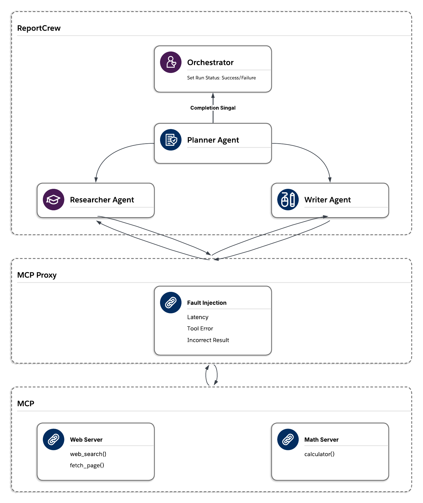

# MCP Chaos Proxy

## Overview

A minimal fault-injecting MCP proxy for exploring how tool failures affect tool-using systems. It forwards tool discovery and calls to an upstream MCP server and can inject latency, tool errors, and plausible incorrect calculator results. It runs locally without an LLM, API key, or paid service.



The diagram illustrates the **conceptual ReportCrew scenario**, including agents and separate web and math servers. This repository implements the standalone proxy and a demo client, not the agents or orchestrator. Its demo uses one toy MCP server exposing all three tools; the proxy connects to one upstream server at a time.

## Project Structure

```text
src/mcp_chaos_proxy/
  server.py       MCP proxy, toy server, and HTTP transport
  engine.py       Fault configuration, decisions, injection, and logging
examples/
  demo_client.py  Client for direct or proxied tool calls
  run_demo.py     End-to-end demonstration of the four scenarios
tests/            Automated tests
logs/             Captured demo results and fault events (JSONL)
config.json       Fault policies and random seed
pyproject.toml    Project metadata and dependencies
```

## Getting Started

Python 3.11 or newer is required. The project was tested with Python 3.13.

```sh
python3 -m venv .venv
source .venv/bin/activate
pip install -e '.[test]'
```

Start the toy server in one terminal:

```sh
python -m mcp_chaos_proxy.server toy --port 8001
```

In a second terminal, activate the same virtual environment and start the proxy:

```sh
python -m mcp_chaos_proxy.server proxy --port 8000 --config config.json --log faults.jsonl
```

In a third activated terminal, call the calculator through the proxy:

```sh
python examples/demo_client.py --tool calculator --expression '20 * 5'
```

With the default configuration all faults are disabled, so the result is `100`. The proxy listens on port 8000 and forwards calls to the toy server on port 8001.

## Configuration

Edit `config.json` to select a tool, fault type, probability, enabled state, and parameters. For example, this configuration always adds a two-second delay to calculator calls:

```json
{
  "seed": 42,
  "faults": [
    {
      "tool": "calculator",
      "type": "latency",
      "probability": 1.0,
      "enabled": true,
      "parameters": {"delay_ms": 2000}
    }
  ]
}
```

The proxy reads the file at startup; **restart it after editing**. Probability must be between 0 and 1. The supported types are:

- `latency`: `delay_ms` is nonnegative; the call continues after the delay.
- `error`: `message` is returned as an MCP tool error (`isError=true`); upstream is not called.
- `offset`: `offset` is added to a successful calculator result. Both the structured result and its text representation are updated, while the call remains successful.

The supplied `config.json` includes disabled latency and error examples for each of the three tools, plus a calculator offset example. Enable the policy you want to try. Offset applies only to `calculator`. Injected events are appended to the configured JSONL log; timestamps are UTC. Do not put secrets in policy parameters or error messages because these can appear in the log.

## Demo and Tests

To establish a baseline, start the toy server and call it **directly**, without the proxy:

```sh
python examples/demo_client.py --url http://127.0.0.1:8001/mcp/ --tool calculator --expression '20 * 5'
python examples/demo_client.py --url http://127.0.0.1:8001/mcp/ --tool web_search --query alpha
python examples/demo_client.py --url http://127.0.0.1:8001/mcp/ --tool fetch_page --page-url https://example.com/alpha-report
```

The calculator returns 100; search finds the fictional Alpha report; fetching that fixture returns status 200 and its text. To compare through the proxy, start it with all faults disabled and run the same commands without `--url`; the client defaults to port 8000.

Run all four scenarios and the unit tests:

```sh
python examples/run_demo.py
pytest -q
```

The demo starts temporary servers on ports 18000 and 18001 and verifies normal forwarding, latency, and tool errors for all three tools. It also verifies a calculator result offset. It uses temporary policies and does not modify `config.json`. It overwrites [logs/results.jsonl](logs/results.jsonl) and [logs/faults.jsonl](logs/faults.jsonl) with its observations. The included files are from an actual run. Ensure those ports are free before running it. The results show the client responses; the fault log records each injection, including the original and modified values for the offset.

## Design Choices

- **Transport:** Streamable HTTP and the official MCP Python SDK support a local client–proxy–server demo. The proxy reconstructs SDK messages rather than forwarding bytes unchanged.
- **Faults and reproducibility:** JSON policies control selection. A fixed seed reproduces decisions for the same sequential call order and process lifetime. Latency and errors are applied before the upstream call; offsets after a successful result.
- **Local fixtures:** search and fetch use fictional local documents, making the demo independent of the internet. The calculator evaluates basic arithmetic without unrestricted `eval`.
- **Logging:** injected events are recorded as JSONL without tool arguments or complete results.

## Known Limitations

- **Protocol scope:** initialization, `tools/list` and `tools/call` over stateless Streamable HTTP are supported (tested with protocol version 2025-11-25). Pagination, notifications, resources, prompts, authentication, streaming progress and cancellation propagation are not implemented. Each upstream operation uses a fresh session, so stateful tools are out of scope. Upstream protocol errors may be converted by the SDK into tool errors.
- **Result corruption:** offset injection applies only to a successful calculator result with numeric `structuredContent.result`; other results are not modified.
- **Reproducibility and operation:** concurrent scheduling can change the order of random draws. Logs are local, append-only, and not rotated. The demo has no authentication and is intended for loopback use. Transitive dependencies are not locked.

## Future Extension: MCP Gateway

For an environment already using IBM ContextForge, a future adapter could connect the fault engine to its `tool_pre_invoke` and `tool_post_invoke` plugin hooks, applying pre-call faults and result modifications inside the gateway. The adapter would need to map gateway payloads to the engine and verify client-visible error semantics against a specific ContextForge version. The engine currently uses MCP result types but is independent of HTTP; this gateway integration has **not been implemented or tested**. See the [ContextForge plugin documentation](https://github.com/IBM/mcp-context-forge/blob/main/docs/docs/using/plugins/index.md).
